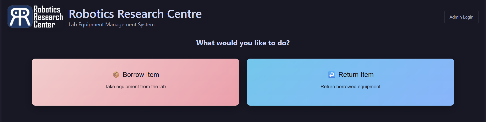

# RRC Inventory Management System

<div align="center">
  
</div>

<div align="center">
  <h3> Simple Lab Equipment Management</h3>
  <p style="color: #f2cdcd;">A web application for managing lab equipment inventory of Robotics Research Centre</p>
</div>

<div align="center">
  


</div>

---

## 📸 Preview

<div align="center">
  
</div>

---

## 🚀 Quick Start

### Prerequisites
- Docker and Docker Compose installed on your system

### Getting Started

1. **First-time setup (run once):**
   ```bash
   ./setup.sh
   ```

2. **Start the application:**
   ```bash
   ./start.sh
   ```

3. **Network access (host IP)**
  Use the server IP to access the application. mDNS/Bonjour support has been removed from this distribution; IP access is more reliable across networks and environments.

4. **Access the system:**
  - **Local Access**: http://localhost
  - **Network Access** (via IP): http://[SERVER-IP]
   - **Log in**: the first server admin uses the credentials you set in `.env` (see below)

> **🔐 First server admin:** Copy `.env.example` to `.env` and set `POSTGRES_PASSWORD`,
> `ADMIN_USERNAME` and `ADMIN_PASSWORD` before the first start. The first account is
> created only once, on an empty database, and logs in with `ADMIN_USERNAME` in the email
> field. If `ADMIN_PASSWORD` is left empty, a random password is generated and printed in
> the backend logs (`./logs.sh`). Never commit `.env`.

### 👥 Accounts and access

Everyone signs up at `/register` (name, email, phone, and whether they are a student,
intern or prof). New accounts wait until a server admin approves them in **Admin → Users**.

Each account is in one group - **Student, Intern, Prof, Lab Admin** or **Server Admin** -
and the group decides what it can do by default:

| Group | Can by default |
|---|---|
| Student, Intern | Borrow, book the mocap lab and mech lab robots, send prints |
| Prof | The same, plus: own bookings and loans need no sign-off, and create research threads. Profs don't sign off for others. |
| Lab Admin | Everything a Prof can, plus sign off robot bookings, thread robot access and loans, and manage inventory, printers and bookings |
| Server Admin | Everything, including managing users |

Nobody can pick Lab Admin or
Server Admin when signing up - a server admin moves people into those groups. Someone who
signs up as Prof is checked when their account is approved. Server admins edit
those defaults in the **Groups** grid, and can grant or revoke anything for one person
under **Access**. Server admins also reset
forgotten passwords from the Users list; there is no email.

Admin accounts from before accounts existed are carried over on first start and keep
their username and password (type the username in the email field). Former super admins
become Server Admins; other former admins go into a **Lab Admin** group that runs
inventory, printers and bookings but cannot manage users.
Keep at least two Server Admins so the lab is never locked out.

### 🖨️ 3D printer status

The **3D Printers** page shows live status for the lab's Bambu Lab P1S printers -
whether each one is free or printing, progress, time remaining, temperatures and a
camera view (about one frame every two seconds, which is the fastest the P1S allows
over the local network). Anyone can view it.

**Stopping a print needs Control printers access.** Those users get a Stop button on a
running printer, with a confirmation naming the job; the action is recorded and
shown on the card ("Last stopped by ..."). Everyone else sees status only - if
they need a print stopped, they ask an admin. That is the one command the system
can send; nothing else writes to the printers.

Configure the printers in `.env`:

```
PRINTERS=Name|host|serial|accesscode,Name2|host2|serial2|accesscode2
```

Enable **LAN Only Mode** on each printer, then read its access code off the screen.
`tools/printer_discover.py` prints the name, IP and serial of every printer on the
network. Leave `PRINTERS` unset and the page simply shows nothing.

> The server must be able to reach the printers' network. Access codes are
> credentials - keep them in `.env`, never in the repo.

**If a printer's access code changes** (toggling LAN mode regenerates it), the
printer page shows an **⚠️ Access code changed** warning on that printer, and a
logged-in admin can paste the new code straight into the page. It reconnects by
itself - no editing `.env`, no restart, no downtime. The new code is saved in the
database and overrides `PRINTERS` from then on, so it survives restarts too.

### 🧵 AMS filament

Printers with an AMS show every slot: material, colour, how much is left, and
which one is feeding, plus the unit's humidity reading and temperature. The
external spool is shown too.

All of it comes from the spool's RFID tag, so it is only as good as what the
printer knows: genuine Bambu spools identify themselves, while third-party
filament has no tag and shows whatever was set by hand on the printer screen,
with the amount as "? left".

### 📤 Sending files to a printer

Anyone logged in with **Send files to printers** access (all groups by default) can send a sliced `.3mf` or `.gcode` from the **3D Printers** page - drag
it onto the printer's card or tap to choose one. The file lands on the printer's
storage, and the print is started from the printer's own screen once somebody
has checked the plate is clear. That removes the need to switch onto the printer
wifi just to press Print in Bambu Studio; slicing still happens in Studio.

File names should start with the owner's name (`srinath_bracket.3mf`) - the
printer reports the file name, so that is how the site shows whose print is
running. Admins can delete files from the printer to stop the storage filling up.

> Starting a print, stopping one, and deleting files need **Control printers** access
> (Server Admins by default).

### 🎥 Booking the Motion Capture Lab and Mech Lab robots

**Motion Capture Lab** (`/mocap`) and **Mech Lab** (`/mechlab`) each show a week calendar.
Anyone can look; booking needs an account. Each robot (and the mocap lab itself) has its
own calendar. Click an empty slot to book it, and cancel your own booking from the
calendar. People who manage bookings can also book on someone else's behalf.

Some robots have extra rules, set per robot:

- **Only research threads with access can book it** - you book it for one of your research
  threads (picked in the booking form), and only if that thread has access (below).
- **Needs approval** - your booking shows as pending (hatched) until a lab admin (anyone with
  *approve robot bookings*) approves it. Approving one request declines the others for the
  same slot. A request nobody approved before its start time just lapses.
- **Limits** - the longest single booking (12 hours if not set) and how many upcoming
  bookings one person may hold.

**No-shows.** From 15 minutes after a booking starts, someone with their own booking on that
robot that day, or a lab admin or booking manager, can report "They didn't turn up" (their
name is kept with the report). Two no-shows in 30 days pauses that person's booking until
the older one is 30 days old. A no-show reported by mistake can be cleared by anyone who
manages bookings.

Robots are added and edited in **Admin → Bookings → Robots and labs**.

### 🧪 Research threads

Research threads (`/threads`) decide who books which robot. A thread is a project:

- A prof (anyone with *create research threads*) creates it and becomes its **lead**, and
  adds or removes members.
- The lead asks for access to a robot. A lab admin (*approve robot bookings*) signs it off,
  optionally with a **weekly allowance** in hours, and can change the allowance or withdraw
  access at any time. A lab admin's own request is approved straight away. Declined
  requests just disappear.
- Members then book that robot for the thread; the booking is tagged with the thread's name.
  The allowance counts the thread's pending and approved hours on that robot in the
  Monday-Sunday week the booking starts. Lab admins can go over it.
- Withdrawing access stops new bookings; bookings already made stay.

Lab admins can also edit or deactivate any thread.

### 📊 Dashboard

**Dashboard** (`/dashboard`) is for everyone logged in. There is nothing to configure.

- **Needs you** - only things to act on, each shown to people who can act on it: your overdue
  loans, tracked items you look after to confirm, bookings, loans and thread robot access to
  sign off, overdue loans across the lab, items with a reported problem, tracked items not
  confirmed in a month, sign-ups waiting, and a warning if there are fewer than two Server
  Admins.
- **My research threads** - members, robot hours used against the allowance this week,
  upcoming bookings, and the gear members hold.
- **Lab usage** (Lab and Server Admins) - robot hours and thread hours over the last 4 weeks,
  the most borrowed items over 90 days, and no-shows.

### 🧰 Borrowing equipment

Borrowing needs an account. Pick the item, or type its name - a name the system has not
seen adds it to the catalogue, so the catalogue builds itself as people borrow. Names match
ignoring case, spaces and punctuation ("RealSense D435i" = "realsense-d435i"). The form is
item, quantity and a return day (Today / Tomorrow / 3 days / 1 week / pick a date) - no photo.
What you have shows at the top of the home page with an **I've returned it** button.

**What's in the lab** (`/items`) lists every item and who has it right now. If someone hands
you something directly, click **I have this now** - their loan closes and one opens for you.
Anyone can report a problem with an item (or clear it once fixed).

**Overdue loans.** The system reminds you the day before an item is due and again once it
is overdue. Answer on your **Account** page: *Still using it* (+7 days from today),
*I returned it*, or lost. A loan 7 or more days overdue pauses your borrowing and booking until you answer.

**Per-item rules**, set by inventory managers:

- **Lab only** - a warning that the item should stay in the lab.
- **Needs approval** - the loan waits for a lab admin (anyone with *approve loans*).
- **Tracked** - for valuable gear. Borrowers tick that they take responsibility, and the
  item's custodian gets a monthly "is it where the system says?" check.

Loans made before accounts existed are still returned with the phone number they were
made with.

### 🔔 Notifications

There is no email. Thread access requests, approvals, overdue reminders, no-show reports and
monthly checks all arrive under the 🔔 bell at the top of the site once you are logged in.

### 🔒 HTTPS

The site is served on plain `http://` (port 80) as always, and also on
`https://` (port 443) for the address set in `.env`:

```
SITE_HOST=10.1.69.243
```

then `./restart.sh`. There is no redirect: `http://` keeps working for everyone.
The certificate is signed by Caddy's own local CA, so browsers show a warning
until that CA is trusted. To trust it, export the root certificate:

```bash
docker compose exec caddy cat /data/caddy/pki/authorities/local/root.crt > rrc-root.crt
```

and import `rrc-root.crt` as a trusted root on each device (or accept the
warning once per browser). The CA lives in the `caddy_data` volume, so it stays
the same across restarts and rebuilds.

Also set `ALLOWED_ORIGINS` in `.env` to every address the site is opened on,
e.g. `ALLOWED_ORIGINS=http://10.1.69.243,https://10.1.69.243`.

Uploads are capped at the proxy: 220 MB for files sent to a printer, 15 MB for
everything else.

> **🌐 Network Access Note:** This website is hosted locally on a server. To access it, you need to be connected to **wifi@iiith** or use **OpenVPN** to connect to the IIIT network.

5. **Stop the application:**
   ```bash
   ./stop.sh
   ```

---

## 💾 Data, backups and portability

All data lives in Docker named volumes, so it survives `./stop.sh` / `./start.sh`,
reboots and rebuilds:

| Volume | Holds |
|---|---|
| `postgres_data` | Loans, bookings and user accounts |
| `uploads_data` | Item photos |

> ⚠️ `docker compose down -v` deletes those volumes and everything in them. Plain
> `down` (what `./stop.sh` uses) is safe.

### Making a backup

```bash
./backup.sh
```

Writes one self-contained archive to `backups/` holding a full database dump plus
every item photo. The system must be running; if the database or the backend
container is down, or the photos cannot be copied out, it fails with an error
instead of writing an incomplete archive. `backups/` and the archives are
readable by the owner only - they hold borrowers' names and phone numbers. Copy that single file anywhere - a laptop, a pen drive, cloud
storage - and it is everything needed to rebuild the system.

### Restoring

```bash
./restore.sh backups/rrc-backup-20260811-205403.tar.gz
```

Replaces the current database and photos with the contents of the archive, after
asking for confirmation. Before touching anything it saves the current data to
`backups/rrc-pre-restore-*.tar.gz`, so a restore of the wrong file can itself be
undone. The backend is stopped while the restore runs and started again
afterwards; the database is restored in a single transaction, so a broken dump
changes nothing. An archive with no photos in it leaves the current photos in
place rather than wiping them. This is also how you move the system to a new machine:
clone the repo there, copy the `.env` and the archive over, `./start.sh`, then
restore.

### Automatic daily backups

`./backup.sh --cron` is the non-interactive mode: it prints nothing unless
something goes wrong, keeps the newest 14 `rrc-backup-*` archives and deletes
older ones (`--keep N` changes the number; safety copies from `restore.sh` are
never pruned). It exits non-zero on any failure, so cron reports it.

Install it in the crontab of the user that runs the system (that user must be
in the `docker` group - cron cannot answer a sudo prompt):

```bash
crontab -e
# then add, adjusting the path:
30 2 * * * /home/USER/RRC-Inventory/backup.sh --cron >> /home/USER/RRC-Inventory/backups/backup.log 2>&1
```

`backups/backup.log` then only ever contains errors; an empty log means every
night succeeded. Copy archives off the machine now and then - a backup on the
same disk does not survive that disk.

Admins can also export **Loans** and **Mocap Bookings** as CSV from the Admin page
for a human-readable copy (spreadsheets, reports) - though CSV does not include
photos, so it is not a substitute for `./backup.sh`.

---

## 🛠️ Technology Stack

<table align="center">
<tr>
<td align="center"><strong>Frontend</strong></td>
<td align="center"><strong>Backend</strong></td>
<td align="center"><strong>Database</strong></td>
<td align="center"><strong>Deployment</strong></td>
</tr>
<tr>
<td align="center">SvelteKit + TypeScript</td>
<td align="center">Go + Gin Framework</td>
<td align="center">PostgreSQL</td>
<td align="center">Docker Compose</td>
</tr>
</table>

---

## ✨ Features

### 👥 For lab members
- **Borrow and return equipment**, and see who has what in **What's in the lab**
- **Book** the Motion Capture Lab and Mech Lab robots, for your research threads
- **Research threads**: profs create them, add members and ask for robot access
- **Dashboard**: what needs you, and how your threads are doing
- **Send prints** to the 3D printers and watch their status
- **Account page**: your loans, bookings, overdue answers and change password

### 🛡️ For lab admins and server admins
- **Approve** robot bookings, threads' robot access (with weekly hours) and loans of items that need approval
- **Manage robots**: rules and limits for each robot
- **Lab usage** on the Dashboard: robot and thread hours, most borrowed items, no-shows
- **Tidy the catalogue**: merge duplicates, mark items tracked, set a custodian
- **View History**: Complete searchable history of all equipment
- **User Management**: Approve sign-ups, set groups and per-person access (Server Admins)

Handing the server over to someone new? See [docs/RUNBOOK.md](docs/RUNBOOK.md).

---

## 📖 Usage

1. **Visit** http://[SERVER-IP] in your web browser (replace [SERVER-IP] with your server's LAN IP)
2. **Sign up** at `/register` and wait for a server admin to approve you, then log in
3. **Borrow, book and print** from the home page
4. **Dashboard** shows what needs you; **managers** also get the Admin link

> **🔗 Access Requirements:** Make sure you are connected to **wifi@iiith** or have **OpenVPN** configured to access the IIIT network before using the system.

Note: mDNS/Bonjour references have been removed. Use the server IP address to access the application.

---

## ⬆️ Upgrading

```bash
./backup.sh            # always, before pulling new code
git pull
./restart.sh --build   # rebuilds the images and starts the new version
```

The database is updated on start. The first start with accounts carries the old admin
logins over as Server Admins (username in the email field) and moves existing mocap
bookings onto the Motion Capture Lab calendar. Step-by-step maintenance is in
[docs/RUNBOOK.md](docs/RUNBOOK.md).

---

## 🔧 Management Commands

```bash
./setup.sh             # First-time setup (builds Docker images)
./start.sh             # Start all services
./stop.sh              # Stop all services and disable autostart
./stop.sh --no-disable # Stop all services, keep autostart (what systemd uses)
./restart.sh           # Restart, leaving autostart as it is
./logs.sh              # View system logs
./backup.sh            # Back up database + photos (--cron for unattended runs)
./restore.sh <archive> # Restore a backup (saves a safety copy first)
```

---

<div align="center" style="border-top: 2px solid #f2cdcd; padding-top: 20px; margin-top: 40px;">
  <p style="color: #cdd6f4;">Created with ❤️ for Robotics Research Centre</p>
  <p>
    <a href="https://github.com/Srindot" style="color: #f2cdcd; text-decoration: none;">👨‍💻 Developer</a> | 
    <a href="https://github.com/catppuccin/catppuccin" style="color: #f2cdcd; text-decoration: none;">🎨 Theme</a>
  </p>
</div>
